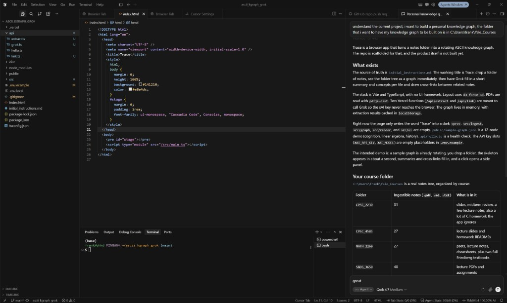

# kgraph

A Yale notes folder, drawn as a knowledge graph you can spin, click, and hand to a friend.

Drop in lecture PDFs and markdown. Courses become branches. Each note gets a short summary, and lines appear where the work actually connects: CPSC beside linear algebra, a history seminar beside cognitive science, two readings that turned out to be about the same idea. The graph is ASCII and slowly turning, the kind of thing you leave open on a library laptop.

It is built for the weeks Yale students already live in. During reading period, the semester has a shape without rereading every GoodNotes export. The night before an exam, a click opens the summary and the concepts in your own material. In shopping period, add a friend by their Yale email and walk their graph — art history, physics, ecology, music — before you ask what the class felt like. grokbot sits in the corner for “what have I learned?” and “what Yale course should I take next?”

## Try it

1. Drop a folder of notes, or open one with **set different root directory**. PDFs, markdown, and text.
2. Drag to rotate. Hover to light up a note and its links. Click for the summary, the concepts, and the notes it connects to.
3. Open **friends**, search a Yale email, and step into their graph. The index lists concepts you share.
4. Open **grokbot** and ask about the graph on screen.

Your files stay on your computer.

## Run locally

```
npm install
npm run dev
```

## Built with Grok

Grok is the model inside the app, and the one that built it. The shot below is Cursor on this repo with the agent set to Grok 4.7, writing the graph from a real Yale course folder.


